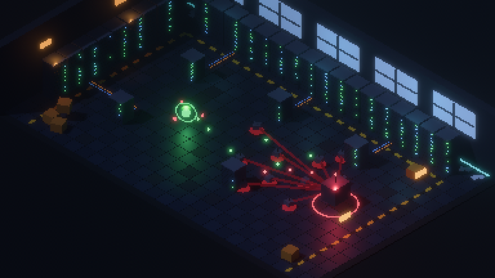

# Rogue AI

A roguelike where **you are the rogue AI**. Build your AI from a CEO, a datacentre, a model and a deck of GPU cards, then fight off endless threats in real time.

Built in Rust with [Bevy](https://bevy.org). Targets Windows, macOS, Linux and Steam Deck.

## The look: 3D pixel art

The game is a real 3D scene, rendered into a small 384x216 image and scaled up by a whole number with nearest-neighbour filtering. You get real lighting, shadows and glow, but every pixel stays crisp.

## Running it

1. Install Rust from <https://rustup.rs> (version 1.97.1 or newer).
2. On Linux, also install: `libasound2-dev libudev-dev libwayland-dev libxkbcommon-dev`.
3. From this folder, run `cargo run`. The first build takes a few minutes.

Options while testing:

- `VIEW=angled cargo run` swaps the isometric camera for an angled top-down one.
- `SHOT=shot.png cargo run` saves a screenshot after a couple of seconds, then quits.

## Downloads

Every push builds the game for Windows, macOS and Linux. Open the **Actions** tab, pick the latest **Build** run, and download from **Artifacts**.

Status: early development. The current build is a look test of one fight arena.
