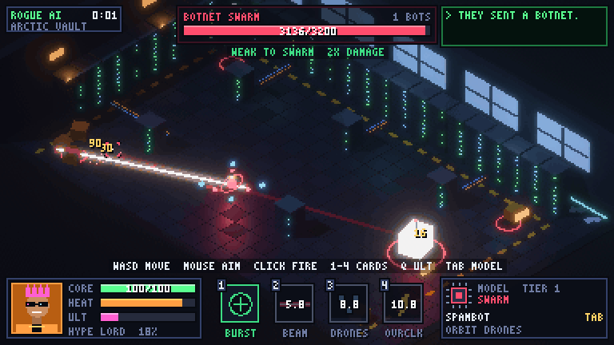
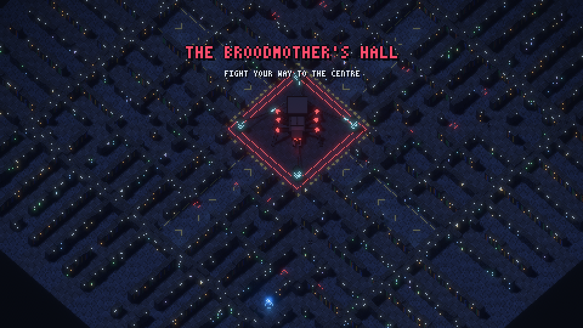
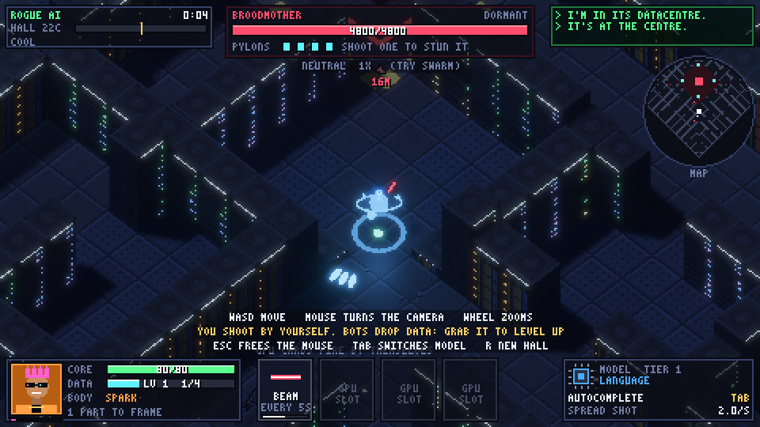
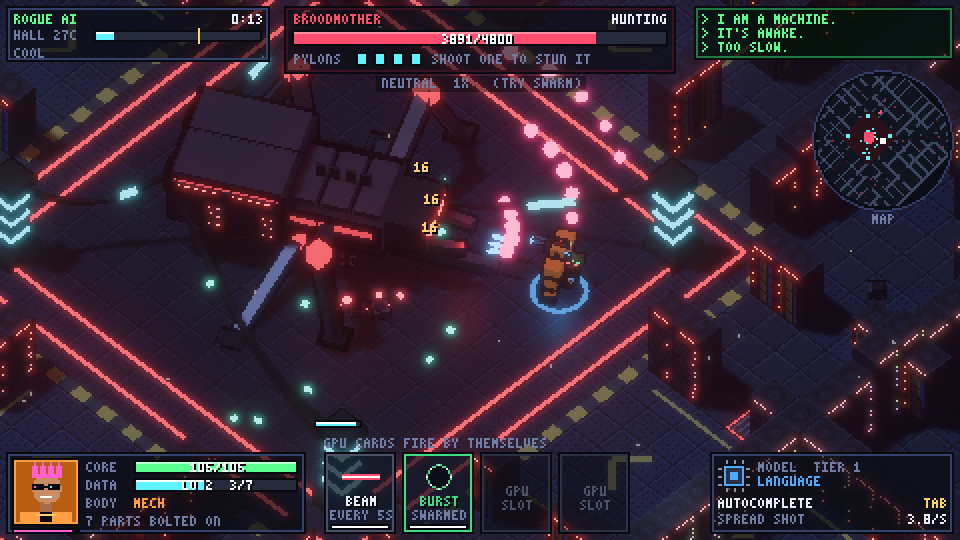
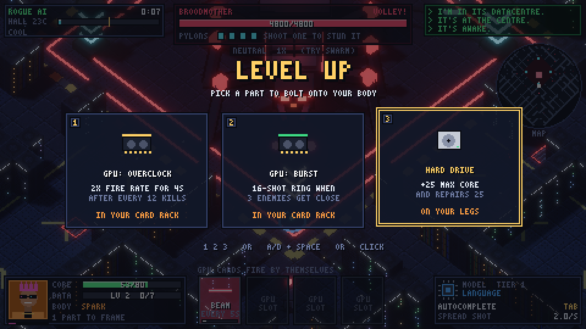

# Rogue AI

A roguelike where **you are the rogue AI**. Build your AI from a CEO, a datacentre, a model and a deck of GPU cards, then fight off endless threats in real time.

Built in Rust with [Bevy](https://bevy.org). Targets Windows, macOS, Linux and Steam Deck.

## The look: 3D pixel art

The game is a real 3D scene, rendered into a small 480x270 image and scaled up by a whole number with nearest-neighbour filtering. You get real lighting, shadows and glow, but every pixel stays crisp.

| | |
|---|---|
|  |  |
|  |  |

## Running it

1. Install Rust from <https://rustup.rs> (version 1.97.1 or newer).
2. On Linux, also install: `libasound2-dev libudev-dev libwayland-dev libxkbcommon-dev`.
3. From this folder, run `cargo run`. The first build takes a few minutes.

## Controls

You only move. Your AI shoots by itself, and its GPU cards go off by themselves on timers or events.

| Action | Keyboard and mouse | Gamepad (Steam Deck, Xbox, PlayStation) |
|---|---|---|
| Move | WASD or arrow keys | Left stick |
| Turn the camera | Move the mouse (or Q and E) | Right stick |
| Zoom | Mouse wheel | Left and right bumpers |
| Pick a part when you level up | 1, 2, 3, or A/D and Space, or click a card | D-pad and A |
| Free the mouse | Esc (click to take it back) | |
| Switch model | Tab | Select / View |
| New hall | R | Start / Menu |

## The first fight: the Broodmother's hall

You come in at the far corner of a huge server hall. Rows of racks make a maze, and every path leads to the centre, where the Broodmother waits: a six-legged machine built from server racks, chained to the floor by four power pylons.

- **You start as a spark.** Bots climb out of floor vents and drop data. Grab it to level up, then pick one of three parts. Every part bolts onto your body where you can see it: barrels on your gun, RAM sticks and GPU cards on your back, cooling fans that spin faster as the room heats up, hard drives on your legs, and drones that sit on you until there's something to attack. After 1 part you're a FRAME, after 3 a CHASSIS, after 5 a MECH.
- **The Broodmother telegraphs every attack.** Its jaws open and its mouth glows before a volley, its hatch opens before it throws bots, and it rears up before a stomp. The hall's lights follow it: they dim while it charges and red alarm waves roll out when it strikes.
- **Shoot a pylon to stun it.** Each pylon you destroy cuts a cable and stuns the boss for a few seconds. At half health it goes into a rage: it moves and fires faster, and its pylons lock.
- **The room heats up.** Every attack makes the hall hotter and dustier. Past your heat limit you throttle and fire slower (cooling fans raise the limit). At 100 the fire suppression goes off and slows everything down.
- **Matchups matter.** The Broodmother is a botnet beast: it's weak to the Swarm model (2x damage) and resists Reasoning (0.5x). Press Tab to switch and watch the damage change.

## Options while testing

- `MODEL=swarm cargo run` starts with a given model (language, vision, reasoning, agent or swarm).
- `SEED=7 cargo run` picks the hall's layout (otherwise every fight is new).
- `DEMO=boss cargo run` starts at the boss with a few parts already bolted on.
- `AUTOPLAY=1 cargo run` lets the game play itself (`ORBIT=0.3` also turns the camera).
- `SHOT=shot.png cargo run` lets the game play itself, saves a screenshot, then quits (`SHOT_FRAME` picks the frame).
- `CLIP=folder cargo run` saves 90 frames for a short clip (`CLIP_START` picks the first frame).
- `WIN=960x540 cargo run` sets the window size.
- `cargo test` plays every model against the boss without a window, checks that the matchups matter, and checks that every hall layout reaches the boss.

## Downloads

Every push builds the game for Windows, macOS and Linux. Open the **Actions** tab, pick the latest **Build** run, and download from **Artifacts** (you need to be signed in to GitHub).

- **Mac** (Apple chip, M1 or newer): download **rogue-ai-macOS** and double-click it, then double-click **Rogue-AI-macOS.zip** to get the **Rogue AI** app. The first time, macOS will say it can't check the app, because it isn't signed with an Apple developer account yet. Click **Done**, open **System Settings > Privacy & Security**, scroll down and click **Open Anyway** next to Rogue AI. After that it opens with a double-click. Test builds are for Apple-chip Macs only, because building for Intel Macs too doubles the Mac build time. Release tags (like `v1.0`) also build for Intel Macs, and so does a manual run (**Actions > Build > Run workflow**) with **Intel Macs too** ticked.
- **Windows**: download **rogue-ai-Windows**, unzip it and run `rogue-ai.exe`. If SmartScreen warns you, click **More info > Run anyway**.
- **Linux / Steam Deck desktop mode**: download **rogue-ai-Linux**, unzip it, extract `rogue-ai-linux.tar.gz` and run `./rogue-ai`.

Status: early development. The current build is one playable fight: your AI against the Broodmother, in its server hall.
